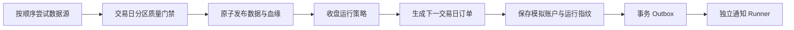

# AShareLens（A股透镜）

本地优先、可解释、可复现的 A 股量化选股平台。

AShareLens 把数据同步、质量门禁、策略参数、历史回测、每日模拟组合、定时运行和消息
推送放进同一套可审计流程。默认使用免费免注册的 BaoStock，不连接券商、不提交实盘
订单，也不会默认把策略、数据或凭据上传到外部服务。

> 项目处于 `0.1.0-alpha`。研究内核、真实日线流程和部署闭环已经可用；涨跌停精确
> 成交规则、公司行动、基本面数据同步和生产认证仍在路线图中。请先阅读
> [当前边界](#当前边界)，不要把模拟结果当作真实可成交收益。

## 为什么是 AShareLens

- **解释型信号**：入选和排除都有稳定理由代码、中文说明、指标快照和数据警告。
- **可复现运行指纹**：策略/版本/参数、行情与基本面快照、执行模型和组合约束共同
  生成指纹。
- **数据质量门禁**：覆盖率、重复记录、日期和交易状态在发布前检查；失败不会伪装
  成“本日无选股”。
- **全程数据血缘**：每个生效交易日保留 Provider、批次、内容哈希、规范化版本和
  质量报告。
- **同一事件内核**：回测和每日模拟都遵循“D 日收盘信号，下一交易日开盘成交”。
- **低运维依赖**：MySQL 同时承担业务存储、事务 Outbox 和持久任务队列，不强制
  Redis/Celery。
- **策略即插件**：Python entry point + Pydantic 参数模型；安装插件后 Web 自动生成
  参数表单。

## 五分钟启动

要求 Docker Engine 与 Docker Compose v2。

```bash
git clone <你的 AShareLens 仓库地址>
cd AShareLens
cp .env.example .env
docker compose up -d --build
```

Windows PowerShell 用：

```powershell
Copy-Item .env.example .env
docker compose up -d --build
```

打开 [http://127.0.0.1:8000](http://127.0.0.1:8000)。首次启动会依次：

1. 启动不暴露宿主机端口的 MySQL 8.4；
2. 执行 Alembic 数据库迁移；
3. 幂等创建工作日 18:00（北京时间）的每日任务；
4. 启动 Web、默认任务 Runner 和独立通知 Runner。

默认股票池只是三只股票的功能示例，不构成推荐。开始使用前请编辑 `.env` 中的
`ASHARELENS_SYMBOLS`、策略参数和资金假设。查看状态：

```bash
docker compose ps
docker compose exec web asharelens database check
docker compose exec runner asharelens runner doctor
docker compose logs -f runner runner-notifications
```

手动投递某个日期的真实数据任务：

```bash
docker compose exec runner \
  asharelens runner enqueue-daily --date 2026-07-30
```

控制台通知会出现在 `runner-notifications` 日志。停止服务不会删除数据：

```bash
docker compose down
```

只有明确需要清空本地 MySQL 数据时才使用 `docker compose down --volumes`。

## 一次每日运行发生什么



首次运行会拉取可配置历史窗口，用最新有效交易日建立模拟账户并产生收盘信号。以后
会顺序补齐未处理的交易日：先在当日开盘执行上一交易日订单，再以收盘价计算净值和
生成新信号。只推送本次最新结果。所有数据源都明确返回空数据时视为休市/无数据并
安全跳过；上游异常进入重试，质量失败则阻断运行。

## 回测成交口径

交易日 D 收盘后生成订单，最早在下一条可见且标记为交易状态的日线开盘执行：

- 买入价：`D+1 开盘价 × (1 + 滑点)`，按最小报价单位向不利方向向上取整；
- 卖出价：`D+1 开盘价 × (1 - 滑点)`，按最小报价单位向不利方向向下取整；
- 结果限制在该交易日最高/最低价范围内；
- 买入数量按 100 股等可配置手数向下取整；
- 佣金、最低佣金、过户费和卖出印花税分别计算并写入成交账本；
- 缺少下一日行情、停牌或现金不足时不成交，该次开盘订单到期，不自动跨日追单。

默认参数位于 `.env.example` 的 `ASHARELENS_EXECUTION_MODEL`。这些是研究假设，不是
券商成交承诺；当前尚未按证券板块和历史日期精确模拟一字涨跌停、集合竞价可成交量
及公司行动。

## 策略

内置四个参数化策略：

| ID | 名称 | 主要用途 | 数据要求 |
|---|---|---|---|
| `moving_average` | 均线趋势 | 快慢均线和确认天数 | 日线 |
| `momentum_rps` | 横截面动量/RPS | 收益、相对强度和流动性 | 多股票日线 |
| `trend_pullback` | 上升趋势回踩 | 趋势、回撤和量能 | 日线 |
| `value_quality` | 价值质量多因子 | 估值、ROE、增长和负债 | 时点基本面 |

Web 参数表单来自 Python 参数模型的 JSON Schema。自定义策略推荐做成独立 Python
包并注册 `asharelens.strategies` entry point；完整示例和安全边界见
[Python 策略插件](docs/strategy-plugin.md)。

```bash
python -m pip install -e ./examples/strategy_plugin
```

插件是与主进程同权限的**受信任 Python 代码**，请只安装自己编写或审查过源码的包。

## 数据源

默认路由为 BaoStock；可以在 `.env` 中按顺序配置：

```dotenv
ASHARELENS_PROVIDERS=baostock,akshare
```

- **BaoStock**：默认，免费免注册，适合沪深日线起步。
- **AkShare**：免费免注册补充源，尤其用于北交所；上游接口变化风险较高。
- **Tushare Pro**：可选注册源；加入列表后配置 `TUSHARE_TOKEN`。

路由按一个请求的完整日期范围回退，不会把不同来源的股票行拼成一个“完整”分区。
成交量统一为股，成交额统一为人民币元。外部数据的许可、频率和稳定性以
[BaoStock](http://baostock.com/)、[AKShare](https://akshare.akfamily.xyz/) 和
[Tushare](https://tushare.pro/document/2)各自条款为准。

## 消息推送

默认 `console` 渠道零配置可用。通用 HTTPS Webhook 可对接自建的飞书、企微或钉钉
中继：

```dotenv
ASHARELENS_NOTIFIERS=console,webhook
ASHARELENS_WEBHOOK_URL=https://example.com/your-relay
```

消息与投递任务在同一个 MySQL 事务写入；通知 Runner 使用租约、心跳和重试。消息体
与 HTTP Header 都携带幂等键。Webhook 地址只存在于运行时环境，不进入任务或错误
日志。

## 本地开发

需要 Python 3.12/3.13 和 Node.js 22.12+。

```powershell
python -m venv .venv
.\.venv\Scripts\python.exe -m pip install -e ".[dev,data]"
.\.venv\Scripts\python.exe -m pytest

Set-Location web
npm ci
npm test
npm run build
Set-Location ..

.\.venv\Scripts\python.exe -m asharelens.cli web
```

不联网的确定性演示：

```powershell
.\.venv\Scripts\python.exe -m asharelens.cli demo
.\.venv\Scripts\python.exe -m asharelens.cli demo --json
```

本地 MySQL 配置与运维命令见 [运维手册](docs/operations.md)，模块边界与可靠性模型见
[架构说明](docs/architecture.md)。

## 能力状态

| 能力 | 状态 |
|---|---|
| 确定性回测、收盘信号与次日开盘模拟 | 已实现 |
| 每日持久模拟账户、解释账本与运行指纹 | 已实现 |
| BaoStock / AkShare / Tushare 日线适配 | 已实现 |
| 数据质量门禁、不可变批次和生效分区 | 已实现 |
| Vue Web 研究台、策略目录、参数表单、离线回测 | 已实现 |
| MySQL Runner、日程、租约、重试、事务 Outbox | 已实现 |
| Console 与通用 HTTPS Webhook | 已实现 |
| Docker Compose 一键部署 | 已实现；本机无 Docker 时由 CI 冒烟验证 |
| 时点基本面同步与价值质量每日流程 | 待实现 |
| 精确涨跌停/公司行动/退市规则 | 待实现 |
| Web 中的真实任务配置、历史结果和权限管理 | 待实现 |
| 实盘交易 | 明确不做 |

## 当前边界

- 这是研究软件，不构成投资建议，也不保证数据正确、服务连续或策略盈利。
- Web `0.1.0` 重点是策略探索和离线回测；真实每日任务当前通过 `.env` 和 CLI 配置。
- `value_quality` 已支持严格时点基本面上下文，但首版数据同步尚未提供基本面 Provider。
- 真实行情可能因上游改版、频率限制、网络、停牌或股票池配置而缺失。
- 当前成交模型不等价于实盘：未完整模拟涨跌停队列、冲击成本、集合竞价流动性和
  公司行动。
- 单个 Python 插件不做安全沙箱隔离；多用户暴露服务前必须增加身份认证和网络防护。

## 项目结构

```text
src/asharelens/
  core/           # 纯领域模型、策略协议、组合和执行内核
  data/           # Provider、规范化、分区和质量门禁
  storage/        # SQLAlchemy/MySQL 仓储
  runner/         # 持久队列、调度和每日工作流
  notifications/  # Outbox 渲染与传输
  server/         # FastAPI 与同源 Web 托管
web/              # Vue 3 + TypeScript
migrations/       # Alembic 迁移
```

## 参与贡献

欢迎问题报告、文档改进、数据源适配和可解释策略。提交前请阅读
[CONTRIBUTING.md](CONTRIBUTING.md) 与 [SECURITY.md](SECURITY.md)。设计讨论优先说明
时点约束、数据血缘、失败语义和可验证测试，而不只展示收益曲线。

## English summary

AShareLens is a local-first, explainable and reproducible A-share stock
screening platform. It provides parameterized Python strategies, deterministic
backtests, daily paper portfolios, traceable multi-source market data, a
MySQL-backed durable runner, notifications, a Vue/FastAPI research workbench,
and one-command Docker Compose deployment. It never places live orders.

## 许可证

[MIT](LICENSE) © 2026 AShareLens contributors.
