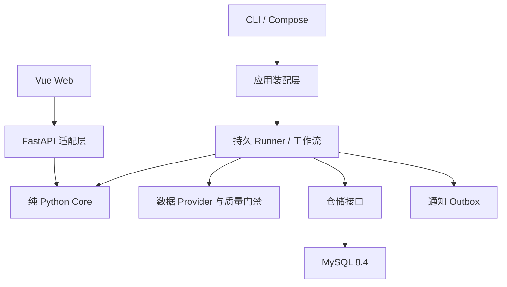

# 架构说明

## 设计目标

AShareLens 是模块化单体：一个 Python 包、一个 Vue 前端、一个 MySQL 数据库，通过
进程边界分离 Web、默认 Runner 和通知 Runner。首版优先降低个人部署复杂度，同时
保留 Provider、策略、通知和任务执行器的替换边界。

依赖方向：



`asharelens.core` 不依赖 FastAPI、SQLAlchemy、具体数据源或通知实现。同一个
`DailyCycleEngine` 既能按历史日期循环，也能从数据库中的上一个组合状态推进一天。

## 每日状态转换

每个交易日按固定顺序执行：

1. 使用当日开盘日线尝试执行上一个交易日留下的订单；
2. 使用当日收盘价计算现金、持仓市值和总净值；
3. 构造只包含截至当日可见行情与基本面的 `StrategyContext`；
4. 策略产生解释型候选；
5. Top-N 等权组合器生成目标权重；
6. 当前持仓与目标持仓之差形成下一交易日订单；
7. 保存候选、订单、成交、费用、净值、状态哈希和运行指纹。

模拟账户按日期加行锁并要求日期单调递增。同一账户、同一日期只有一个不可变运行；
再次提交完全相同的输入返回原结果，策略、数据或执行假设变化则产生显式重放冲突。

## 数据发布与血缘

Provider 返回带来源证据的不可变 `DataBatch`。一个日期范围必须由单个 Provider
完整提供，之后拆为交易日分区：

```text
DataBatch
  ├─ provider/version/fetched_at/request
  ├─ source_batch_id/content_hash/schema_version
  └─ DataPartition[trade_date]
       ├─ normalized DailyBar records
       └─ QualityReport
```

只有通过质量门禁的分区才能移动 `published_partitions` 指针。旧版本不会被覆盖，
历史模拟保存其实际读取的分区 ID，因此上游修订不会改写已经完成的实验。

Provider 回退不做行级混合。所有源都返回空批次是成功的 `no_data`；传输异常可重试；
接口契约或覆盖率失败阻断发布。

## 运行指纹

历史回测指纹包含：

- 策略 ID、版本和策略身份哈希；
- 规范化后的参数；
- 行情与时点基本面内容；
- Core 引擎版本；
- 开盘执行模型、初始资金、Top-N 和单股最大权重。

每日模拟还包含账户 ID、日期、输入组合状态哈希和精确分区列表。指纹用于复现和差异
判断，不是数据加密或数字签名。

## Runner 为什么不依赖 Redis/Celery

首版任务频率是日级，MySQL 已经是必需依赖。`runner_jobs` 使用：

- `SELECT … FOR UPDATE SKIP LOCKED` 领取；
- 有期限租约与心跳；
- 失联任务回收；
- 指数退避和最大次数；
- 业务幂等键与唯一约束；
- 至少一次执行语义。

这使备份、部署和故障排查只围绕一个持久系统。默认队列与通知队列由不同进程领取，
避免慢消息阻塞数据任务。只有实测出现多机高吞吐、秒级调度或 MySQL 锁竞争后，才
值得增加队列适配器；领域工作流和执行器协议无需随之重写。

## 插件边界

- `DataProviderPlugin`：外部数据到规范化批次；
- `StrategyPlugin`：时点上下文到解释型候选；
- `NotifierPlugin`：已渲染消息到外部渠道；
- Runner `JobExecutor`：持久任务到 JSON 安全结果。

策略通过 `asharelens.strategies` entry point 发现，参数模型直接产生 Web JSON
Schema。插件运行在主进程内，只能视为受信任代码。未来若增加进程隔离，应保持当前
协议并把调用替换为 IPC 适配器。

## 稳定性边界

- 数据拉取在数据库事务外进行；接受结果在一个短事务内发布。
- 模拟状态与通知 Outbox 在同一事务写入。
- Web 存活检查不依赖外部数据源，数据库诊断使用独立命令。
- Runner 启动前要求数据库 revision 与代码声明一致。
- Compose 先等待 MySQL 健康，再迁移、初始化日程，最后启动常驻服务。
- Web 默认只映射到宿主机 `127.0.0.1`。
